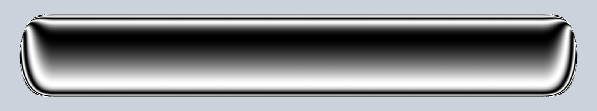

# Flat wing with rounded tips

The STEP contains one valid, closed 800 mm wing solid. The 120 mm chord is constant between the attachment planes at Y = ±350 mm. Both caps share the specified mid-plane rim. The reimported STEP preserves the parent skins and rim to within 1.8 × 10⁻¹³ mm on the measurement grid.

## Build and verify

Use Python with CadQuery 2.8.0 and NumPy. Run these from the project root.

```powershell
python -B flat/build_wing.py
python -B flat/verify_wing.py
```

The builder writes `wing.step`. The verifier opens that exported file and writes `readback.json`, with the STEP SHA-256 and individual maxima with locations. STEP export can include a creation timestamp, so verify after rebuilding.

## Cap construction

The central upper and lower surfaces are exact Bézier representations of the supplied polynomial extruded along Y. Each cap is two tensor-product Bézier patches with the exact same chordwise polynomial. At each fixed chord parameter `u`, a planar wrap begins at its parent-skin boundary. For wrap parameter `t` running from 0 to 1, the cap moves outboard by `200u(1-u)(2t-t²)` and scales the thickness by `1-2t³+t⁴`. The lower half mirrors the upper half. The inward second derivative of the thickness at the attachment is zero. At the lip, the spanwise derivative vanishes while the thickness derivative remains finite at interior chord stations, giving the upper and lower cap halves a common tangent plane and matching normal derivatives. The caps collapse to a point where each tip rim meets the leading and trailing edges.

## STEP readback

- The exported solid has six faces and one closed shell. Its measured span is 800 mm and its tolerance-inflated bounding box chord is 120.0000002 mm.
- The four attachment curves and two rims were checked at 199 stations each over `u = 0.005–0.995`. The largest attachment tangent-plane mismatch was 9.54 × 10⁻¹⁵ degrees and the largest jump in the normal derivative was 2.10 × 10⁻¹⁵ per mm. Ordinary cap surface derivatives degenerate at `u = 0` and `u = 1`.
- The numerical zebra swept three orthographic views and four stripe axes per join, mirrored across the span and thickness. Across 952 located stripe crossings the largest direction change was 1.99 × 10⁻¹³ degrees. The largest sampled phase and gradient changes were 3.20 × 10⁻¹⁴ rad and 8.33 × 10⁻¹⁴ rad/mm.
- Thirteen physical planes normal to X cut both tips. The verifier checks intersection topology and curve endpoints against the STEP surface isocurves, then measures signed curvature from each exact isocurve at 1,001 points per half-wrap. The smallest sampled radius in each of the 52 half-wraps occurs at its lip and there are no sampled sign reversals. Lip radii range from 0.05125 mm at `u = 0.975` to 1.6464 mm at `u = 0.4`. The radius approaches zero at the collapsed rim endpoints.


The centered, edge-free `zebra.png` uses the reimported STEP normals and mirrored stripe lighting. Run `python -B flat/render_zebra.py` with Matplotlib to regenerate it.


