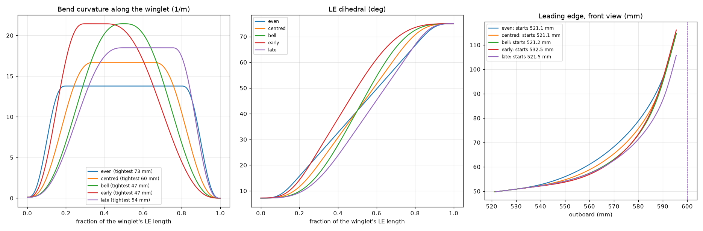

# Wing B blended winglet

The twisted Wing B ([definition](../wing-b-spar/shape/constrained/redistributed/definition.json)) continued into a blended winglet. The 600 mm projected half-span includes the winglet. The trailing edge is blunt at 0.4 mm throughout, so the 0.4 mm minimum radius applies everywhere, including the winglet's leading edge.

| Stage | Status |
| --- | --- |
| 1. Law and outline: edge curves, section planes, checks on the law | **Revised after review; choose a bend distribution** ([stage1](stage1/)) |
| 2. Surface with the tip open; locked blunt parent; STEP readback | Next |
| 3. Close the winglet tip with the [rounded wingtip skill](../../.agents/skills/close-rounded-wingtip/SKILL.md) | |
| 4. Whole-surface curvature map and zebra review | |
| 5. A follow-up edit, e.g. move the bend's peak and keep the height | |

## How the winglet is defined

The winglet is not a second body blended onto the wing. Wing B is generated from rules: a leading-edge path, a chord, a twist about the leading edge and the SD7037 section in spanwise-parallel planes ([phase0_geometry](../../src/planeopt/phase0_geometry.py)). [phase0_winglet](../../src/planeopt/phase0_winglet.py) continues each rule past the attachment, starting from the parent's value and its first and second derivatives along the leading edge, so the skin is curvature-continuous with Wing B by construction. The checks below measure it.

The whole winglet is the transition. From the attachment to the tip:

- **Bend.** In the front view the leading edge turns from Wing B's local dihedral (7.3°) to the 75° cant at the tip. Its curvature follows a flat-topped bell. It ramps up from Wing B's curvature over the first `ramp_in` of the winglet's length, holds, and ramps down to zero over the last `ramp_out`. Two settings cover the shape: their sum sets how spread out the turn is (0.5 / 0.5 is a single peak; short ramps spread it evenly) and their ratio moves the peak toward the winglet root or the tip. The peak curvature follows from the turn, so a narrower bell means a tighter bend.
- **Section planes** start spanwise-parallel like Wing B's and rotate until they are normal to the leading edge in the front view at the tip.
- **Leading and trailing edges are drawn.** Each edge's direction in side view blends from Wing B's into its tip direction: 35° sweep for the leading edge, and for the trailing edge whatever sweep gives the 32 mm tip chord. The chord is the distance between them. (The first version tapered the chord independently of the sweep. Its trailing edge came out as an S: forward through the bend, aft up the leg.)
- **Twist** blends from Wing B's washout into 2° toe-out.
- **Section morph.** Each section is split into a camber line and a thickness distribution. The SD7037 camber fades to zero and its thickness blends into a symmetric 10% section (NACA 0010 thickness). The trailing-edge thickness is put back as a ramp fixed at 0.4 mm, so it never scales with the chord. The Airfoil Converter ([d77bbdf](https://github.com/Trying-to-Fly/Airfoil-Converter/tree/d77bbdf45a8c0aa92efbc2a3d3007cfe4f904105)) cuts both end sections' blunt trailing edges with keep-chord, as the cap-radius parents do.

Solving order: the winglet's length meets the 65 mm height; the attachment station meets the 600 mm span (with the tip extended 12 mm along its tangent as an allowance for the cap); the trailing-edge sweep meets the tip chord. The attachment may not come within 10 mm of the aileron hinge's 510 mm end.

## Bend distributions

[Open the viewer](stage1/viewer.html) (download it and open it locally) to switch between them at a fixed camera, shaded or with isophote stripes.

| Variant | Ramps in / out (%) | Starts at (mm) | Height (mm) | Tightest bend radius (mm) | Tip trailing-edge sweep | Smallest LE radius (mm) |
| --- | --- | ---: | ---: | ---: | --- | ---: |
| [even](stage1/variants/even/) | 20 / 20 | 521.1 | 65.0 | 72.6 | 11.2° forward | 0.45 |
| [centred](stage1/variants/centred/) | 35 / 35 | 521.1 | 65.0 | 59.9 | 10.3° forward | 0.45 |
| [bell](stage1/variants/bell/) | 50 / 50 | 521.2 | 65.0 | 46.6 | 9.6° forward | 0.45 |
| [early](stage1/variants/early/) | 30 / 60 | 532.5 | 65.0 | 46.7 | 12.9° forward | 0.45 |
| [late](stage1/variants/late/) | 50 / 25 | 521.5 | 56.0 | 54.1 | 14.1° forward | 0.45 |



A late peak keeps the wing flat longer, so it needs more room sideways. At 65 mm it would have to start inboard of the hinge clearance; the late variant is 56 mm tall instead. The first Stage 1 version was a single 73 mm bend from 540 mm with a 22 mm straight leg; its tightest radius was 33 mm.

## Checks, every variant

| Check | Result |
| --- | --- |
| Projected half-span with the cap allowance | 600 mm to 1e-9 |
| Height, tip cant, tip LE sweep, toe-out, tip chord | as requested, measured on the generated sections |
| Trailing edge | 0.4 mm at every station |
| Join to Wing B (LE and three skin points) | largest gap 1.3e-8 mm; largest second-derivative jump 2.8e-8 per mm against values of about 3e-4 to 9e-4 |
| Bend curvature never negative; dihedral rises throughout; chord decreases throughout; every section has positive thickness | pass |
| Trailing edge moves one way in side view (no S) | pass |
| Trailing edge's opposite bend near the join | 6–10% of its main bend. This is Wing B's own trailing-edge curve carried through the join to keep it smooth. |
| Leading-edge radius | at least 0.45 mm normal to the leading edge, at the winglet tip (0.37 mm in the streamwise section). Sweep makes the cross-section normal to the edge rounder; Stage 4 measures the true principal curvature on the STEP. |

Each variant's folder holds its views, laws along the leading edge, report and curves: [even](stage1/variants/even/), [centred](stage1/variants/centred/), [bell](stage1/variants/bell/), [early](stage1/variants/early/), [late](stage1/variants/late/).

## Findings outside the winglet

- **SD7037's resampled nose has a micron-scale tight spot.** A spline through the Converter's 321-point SD7037 has a radius of about 0.00086 chord right at the foremost point (0.08 mm at 87.5 mm chord), against about 0.008 chord (0.7 mm) over the nose as a whole. The points there are unevenly spaced. The bump is a few microns high, far below what a printer resolves, but a curvature map of Wing B's own CAD would flag it against the 0.4 mm rule. This study resamples every section on one cosine grid, which smooths it out.

## Regenerate

From the repository root, with the pinned Converter extracted somewhere outside the checkout:

```sh
git -C <Airfoil-Converter> archive d77bbdf src | tar -x -C <dir>
uv run --locked --extra phase0 --extra cad python runs/winglet-b/stage1/build.py --converter-src <dir>/src
uv run --locked --extra phase0 --extra cad python runs/winglet-b/stage1/viewer.py --converter-src <dir>/src
uv run --locked --extra phase0 --extra cad python -m pytest tests/test_phase0_winglet.py
```

The tests use a NACA stand-in for the Converter so they run without it.

[Airfoil Converter tools this work needs](CONVERTER_TOOLS.md)
