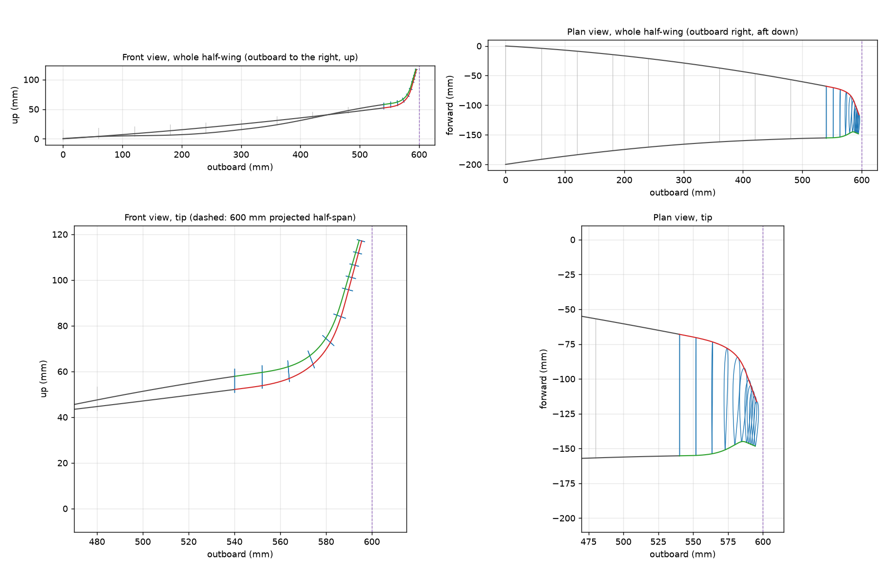
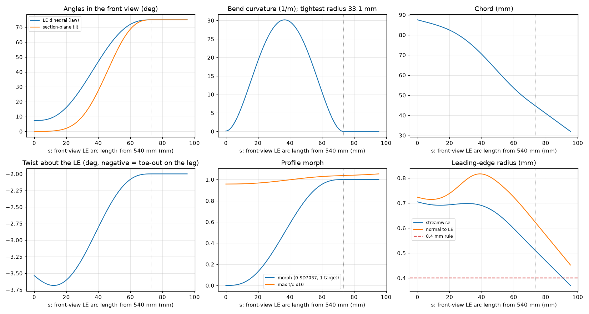

# Wing B blended winglet

The twisted Wing B ([definition](../wing-b-spar/shape/constrained/redistributed/definition.json)) carried past 540 mm into a blended winglet. The 600 mm projected half-span includes the winglet. The trailing edge is blunt at 0.4 mm throughout, so the 0.4 mm minimum radius applies everywhere, including the winglet's leading edge.

| Stage | Status |
| --- | --- |
| 1. Law and outline: leading- and trailing-edge curves, section planes, checks on the law | **Done, awaiting designer review** ([stage1](stage1/)) |
| 2. Surface with the tip open; locked blunt parent; STEP readback | Next |
| 3. Close the winglet tip with the [rounded wingtip skill](../../.agents/skills/close-rounded-wingtip/SKILL.md) | |
| 4. Whole-surface curvature map and zebra review | |
| 5. A follow-up edit, e.g. start the bend later and keep the height | |

## How the winglet is defined

The winglet is not a second body blended onto the wing. Wing B is generated from rules: a leading-edge path, a chord, a twist about the leading edge and the SD7037 section in spanwise-parallel planes ([phase0_geometry](../../src/planeopt/phase0_geometry.py)). [phase0_winglet](../../src/planeopt/phase0_winglet.py) continues each rule past 540 mm. Each continuation starts with the parent's value and its first and second derivatives along the leading edge, so the skin is curvature-continuous with Wing B by construction. The checks below measure it.

- **Bend.** In the front view the leading edge turns from Wing B's local dihedral (7.29°) to the cant angle. Its curvature rises from Wing B's to a single peak and falls back to zero with zero slope, like a railway transition curve, so there is no step in how fast the skin bends at either end. A straight leg follows.
- **Section planes.** They start spanwise-parallel like Wing B's and rotate until they are normal to the leading edge in the front view by the end of the bend.
- **Chord, twist, sweep.** Each blends from Wing B's own trend into its winglet law: a linear taper from 87.5 mm to the tip chord, a constant toe-out, and a constant leading-edge sweep on the leg.
- **Section morph.** Each section is split into a camber line and a thickness distribution. Over the bend the SD7037 camber fades to zero and its thickness blends into the target symmetric section. The trailing-edge thickness is put back as a ramp fixed at 0.4 mm, so it never scales with the chord. The Airfoil Converter ([d77bbdf](https://github.com/Trying-to-Fly/Airfoil-Converter/tree/d77bbdf45a8c0aa92efbc2a3d3007cfe4f904105)) cuts both end sections' blunt trailing edges with keep-chord, as the cap-radius parents do.

The span lock sets the bend length: the bend is lengthened until the outermost skin, with the leg extended by a 12 mm allowance for the tip cap, reaches 600 mm.

## Stage 1 choices and measurements

| | Requested | Measured on the generated sections |
| --- | --- | --- |
| Attachment | 540 mm (aileron hinge ends at 510 mm) | joins Wing B at 540 mm |
| Projected half-span | 600 mm with the cap allowance | 600.000000 mm (596.89 mm without it) |
| Height, attachment LE to winglet-tip LE | 65 mm | 65.000000 mm |
| Cant of the leg | 75° above horizontal | 75.000000° |
| Leg leading-edge sweep | 35° | 35.000000° |
| Toe-out, nose outboard | 2° | 2.000000° |
| Tip chord | 32 mm | 32.000000 mm |
| Target section | symmetric, 10% (NACA 0010 thickness) | |
| Trailing edge | 0.4 mm | 0.400000000–0.400000000 mm at every station |
| Bend | solved | 73.3 mm long; tightest radius 33.1 mm at 36.7 mm along it; dihedral rises steadily: yes |
| Leg | | 22.1 mm long; the chord is 44.9 mm where it starts |
| Join to Wing B, 4 skin and LE points | curvature-continuous | largest position gap 6.1e-9 mm; largest second-derivative jump 3.8e-9 per mm against values of about 3e-4 to 9e-4 |
| Leading-edge radius | ≥ 0.4 mm | smallest 0.452 mm normal to the leading edge (0.370 mm in the streamwise section) at the winglet tip |





The [oblique view](stage1/oblique.png) shows the section outlines in 3D. [report.json](stage1/report.json) has every station; [curves.json](stage1/curves.json) holds the leading-edge, trailing-edge and quarter-chord polylines and 13 section outlines in Wing B's study coordinates (−X outboard, +Y up, +Z forward, mm).

## For the designer to judge

- **Most of the winglet is bend.** At 65 mm high and 75° cant, the span lock leaves a 73 mm bend and only a 22 mm straight leg. A taller winglet, a steeper cant or a tighter bend would lengthen the leg.
- **The trailing edge in plan.** Through the bend the chord shrinks faster than the leading edge sweeps back, so the trailing edge comes forward; on the leg it runs slightly aft again. It is one smooth curve, the usual look of a swept, tapered blended winglet, but it is an S in plan.
- **Leading-edge radius at the tip.** The thin end of the leg sets the limit. Measured normal to the leading edge it is 0.45 mm, which passes. The streamwise section alone would be 0.37 mm, below 0.4 mm; sweep makes the cross-section normal to the leading edge rounder than the streamwise one. A thicker or larger tip section would add margin. Stage 4 measures the true principal curvature on the STEP.
- **Twist.** Wing B's washout is still falling at 540 mm, so the twist continues to −3.7° before rising to the −2° toe-out. That is the parent's own trend carried through, not a separate wiggle.

## Findings outside the winglet

- **SD7037's resampled nose has a micron-scale tight spot.** A spline through the Converter's 321-point SD7037 has a radius of about 0.00086 chord right at the foremost point (0.08 mm at 87.5 mm chord), against about 0.008 chord (0.7 mm) over the nose as a whole. The points there are unevenly spaced. The bump is a few microns high, far below what a printer resolves, but a curvature map of Wing B's own CAD would flag it against the 0.4 mm rule. This study resamples every section on one cosine grid, which smooths it out.

## Regenerate

From the repository root, with the pinned Converter extracted somewhere outside the checkout:

```sh
git -C <Airfoil-Converter> archive d77bbdf src | tar -x -C <dir>
uv run --locked --extra phase0 --extra cad python runs/winglet-b/stage1/build.py --converter-src <dir>/src
uv run --locked --extra phase0 --extra cad python -m pytest tests/test_phase0_winglet.py
```

The tests use a NACA stand-in for the Converter so they run without it.

[Airfoil Converter tools this work needs](CONVERTER_TOOLS.md)
